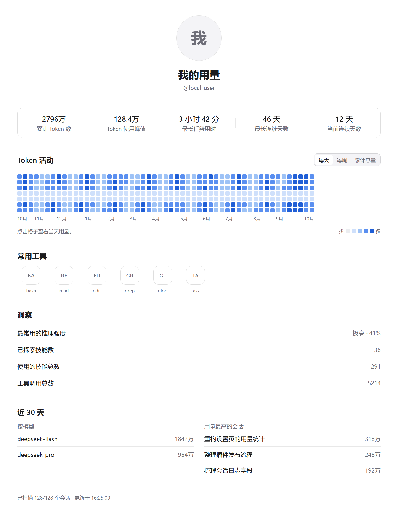
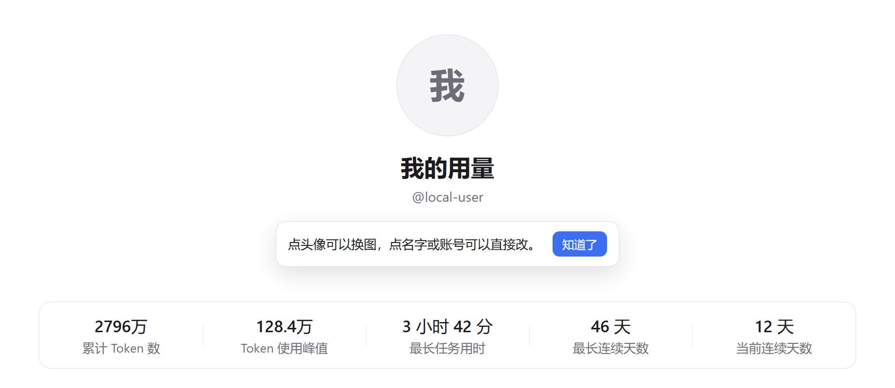

# DSH 的 Codex 用量看板

给 DeepSeek Harness（DSH）的设置页装一个「用量」看板：顶部是**你自己**的名字、账号和头像，下面是五个累计数字、一整年的 Token 活动热力图、常用工具、技能与推理强度，最后是近 30 天的按模型 / 按会话明细。所有数字都从**本机会话日志**折叠出来，不联网、不上传。



## 安装

**从插件页安装（推荐）**

1. 打开 DSH 侧边栏的 **插件** 页，点 **添加插件**。
2. 填入仓库地址：`https://github.com/skystart233-code/dsh-codex-usage-board`
3. 安装完成后打开 **设置 → 用量**。

**从命令行安装**

```bash
dsh plugin --profile <你的 profile 名> add https://github.com/skystart233-code/dsh-codex-usage-board
```

**从插件市场安装**

在 **插件 → 发现** 的索引源里添加下面这个地址，然后搜索「用量看板」：

```
https://raw.githubusercontent.com/skystart233-code/dsh-codex-usage-board/main/index.json
```

## 页面

```
              [ 头像 / 首字圆标 ]
                    名字
                    @账号
┌──────────┬──────────┬──────────┬──────────┬──────────┐
│ 累计 Token │ 使用峰值  │ 最长任务  │ 最长连续  │ 当前连续  │
└──────────┴──────────┴──────────┴──────────┴──────────┘
Token 活动                                  [每天][每周][累计总量]
  10月  11月  12月  1月  2月 …             ← 53 周日历热力图，5 档强度
常用工具
  [BA] [RE] [ED] …   ← 按调用次数排序的 chip
洞察
  最常用的推理强度        极高 · 41%
  已探索技能数                    35
  使用的技能总数                 276
  工具调用总数                  1,234
近 30 天
  按模型 / 用量最高的会话 两列
```

点热力图的格子能看当天（或当周 / 累计到当天）的用量；窄窗口下热力图保持固定格子尺寸、横向滚动，并默认滚到最近一周。

## 自定义名字、账号、头像

看板不绑定任何人，改资料不用进设置、也不用找按钮。第一次打开页面时，名字下面会弹出一次提示，点「知道了」或按 Esc 关掉后就不再出现：



- **头像**：鼠标移上去，头像右下角浮出相机图标，点它选图即可换（PNG / JPEG / WebP / GIF / SVG，≤ 256 KB）。
- **名字 / 账号**：鼠标移上去，文字下面会出现一块灰色输入框的样子，光标变成文本编辑竖线；点一下就地变成输入框，回车或点别处保存，Esc 取消。
- **留空**：名字清空后显示「我的用量」，头像清空后回到首字圆形标记。
- **保存位置**：`~/.dsh/usage-board/profile.json`（或 `$DSH_HOME/usage-board/profile.json`）。删掉这个文件就恢复默认。
- **不想再看到提示**：提示只弹一次，记录在浏览器 `localStorage` 里；清掉它就会再弹。

## 每个数字从哪来

| 展示 | 来源 |
|---|---|
| 累计 Token 数 | 所有 `assistant/message` 的 `usage`，`input + output` |
| Token 使用峰值 | 单日 `input + output` 的最大值 |
| 最长任务用时 | `turn/start` → `turn/end` 的最长墙钟时间 |
| 最长 / 当前连续天数 | 有 usage 的日历日连续段 |
| 推理强度 | `request/header` 的 `config.reasoningEffort` 分布 |
| 技能数 / 技能调用 | `tool/call` 中 `skill` 调用的 `arguments.name` 去重与计数 |
| 工具调用总数 / 常用工具 | 所有 `tool/call` 的 `name` 计数 |
| 按模型 / Top 会话 | 近 30 天窗口内的模型与会话汇总 |

- 日期按**浏览器本地日历日**切分（调用方传 `getTimezoneOffset()`），所以「今天」和你看的一致。
- fork / seeded 会话继承的前缀事件会跳过，避免重复计数。
- 每个会话的汇总按 `sessionPersistence.stat()` 的 revision 缓存，日志不变就不重读。
- 一次最多扫描最新的 500 个会话，页面底部会注明是否截断。

## 实现

- `index.js`（Host）：认证过的 `GET /api/codex-usage.dashboard`（和官方 `/api/session.export` 同一条 `/api` 通道）与 `POST /api/codex-usage.profile`（保存资料），外加只读工具 `usage_board_report`，与页面共用一套聚合。
- `client.js`（Browser）：向 `settings.section` 注册 id 为 `codex-usage` 的页面，向 `settings.action` 注册 `codex-usage-refresh`，所以刷新按钮和「打开配置文件」、关闭按钮同一行；样式只用 `--dsw-alias-*` 主题 token，CSS 随组件挂载 / 卸载。
- 热力图：53 周 × 7 天 = 371 个固定 10px 格子（间距 3px），无记录的日期画浅灰格，未来日期画空心格；月份标签对齐每月第一周。
- `locale/*.json`：插件页里的条目名称与说明；页面文案内置中英两套。

## 隐私

- 只读本机会话日志，只在本机聚合，**没有任何出网请求**。
- 名字、账号、头像只写进 `$DSH_HOME/usage-board/profile.json`，不会进入会话日志，也不会离开本机。
- Host 侧只有一条只读工具 `usage_board_report`，外加两条资料读写路由。

## 已知边界

- 只统计写进会话日志的 provider 用量；没有 usage 上报的请求（如失败请求）不计 token。
- 不做价格换算：单价与缓存折扣会变，显示 token 比显示金额可靠。
- 热力图固定 53 周（约一年）；更早的日期不显示，但累计数字包含它们。
- 老会话若没有 `session/title` 事件，标题退化为首条用户消息的首行。

## 开发

```bash
node test/fold.test.mjs                        # 聚合逻辑，无依赖
node test/profile.test.mjs                     # 资料校验与落盘，无依赖
node test/routes.test.mjs                      # 两条路由与错误分支，无依赖
npm install --no-save react@18 react-dom@18    # 仅渲染测试需要
node test/render.test.mjs                      # 加载中 / 有数据 / 空数据
```

README 里的两张截图由 `tools/preview.mjs` 用真实组件 + 样例数据渲染成静态 HTML，再用 headless Chrome 截图。

## English

A usage dashboard for the DeepSeek Harness Settings page. It folds the local session logs into one profile: five lifetime figures, a 53-week token heatmap, top tools, skills and reasoning effort, plus a 30-day per-model / per-session breakdown. The header is editable — name, handle and portrait live in `$DSH_HOME/usage-board/profile.json`, nothing is baked into the bundle, and no data leaves the machine.

Install from the Plugins page with `https://github.com/skystart233-code/dsh-codex-usage-board`, or `dsh plugin --profile <name> add <that URL>`.

## License

MIT
